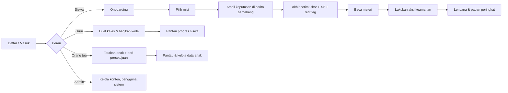

<div align="center">

# 🛡️ Guardian Digital

### Simulasi bergaya game untuk melatih generasi muda mengenali penipuan, investasi bodong, hoaks, dan kebocoran data

**Karya Lomba Web Development · Mulawarman Informatics Tech Week (MIT-Week) 2026**
Tema: *"Guardians of the Digital Space – Empowering Today's Generation Toward a Safer Cyber Ecosystem"*


</div>

---

## 🔗 Tautan Penting

| | |
|---|---|
| 🌐 **Live Demo (InfinityFree)** | https://guardian-digital.gamer.gd |
| 🎬 **Video Demonstrasi** | https://youtu.be/E-vGpW0R8og?si=COJkxim3vC_Yz6i- |
| 📦 **Repositori** | https://github.com/YanuarFaturrahman/guardian-digital |
| 🔐 **Dokumen Keamanan & Privasi** | [docs/KEAMANAN-DAN-PRIVASI.md](docs/KEAMANAN-DAN-PRIVASI.md) |
| 🩺 **Dokumen Keberlangsungan Sistem** | [docs/KEBERLANJUTAN-SISTEM.md](docs/KEBERLANJUTAN-SISTEM.md) |
| 👤 **Akun demo untuk juri** | Lihat bagian [Akun Demo](#-akun-demo) |

---

## 📑 Daftar Isi

1. [Latar Belakang & Studi Kasus](#-latar-belakang--studi-kasus)
2. [Solusi: Apa Itu Guardian Digital?](#-solusi-apa-itu-guardian-digital)
3. [Akun Demo](#-akun-demo)
4. [Fitur Utama](#-fitur-utama)
5. [Isi Konten](#-isi-konten)
6. [Alur Penggunaan](#-alur-penggunaan)
7. [Peran & Hak Akses](#-peran--hak-akses)
8. [Keamanan & Privasi](#-keamanan--privasi)
9. [Keberlangsungan Sistem](#-keberlangsungan-sistem)
10. [Teknologi yang Digunakan](#-teknologi-yang-digunakan)
11. [Struktur Proyek](#-struktur-proyek)
12. [Menjalankan di Komputer Lokal](#-menjalankan-di-komputer-lokal)
13. [Konfigurasi (.env)](#-konfigurasi-env)
14. [Deployment](#-deployment)
15. [Perintah Artisan](#-perintah-artisan)
16. [Pengujian](#-pengujian)
17. [Sumber Pihak Ketiga & Atribusi](#-sumber-pihak-ketiga--atribusi)
18. [Keterbatasan & Rencana Pengembangan](#-keterbatasan--rencana-pengembangan)
19. [Tim](#-tim)

---

## 🎯 Latar Belakang & Studi Kasus

Pelajar dan generasi muda adalah pengguna internet yang paling aktif, sekaligus kelompok yang sering menjadi sasaran:

- **Penipuan online (scam):** kurir palsu, file `.apk` berbahaya, giveaway palsu, permintaan kode OTP.
- **Investasi bodong:** skema Ponzi dan piramida, robot trading, janji untung besar tanpa risiko.
- **Hoaks dan manipulasi informasi:** kabar viral yang dibagikan sebelum dicek kebenarannya.
- **Kebocoran data pribadi:** formulir palsu, kata sandi lemah, privasi media sosial yang terbuka.

Materi literasi digital yang ada umumnya berupa ceramah atau poster. Siswa jarang punya kesempatan **mencoba mengambil keputusan** dalam situasi yang menyerupai kenyataan, tanpa menanggung akibat nyata. Di sisi lain, **guru dan orang tua** sulit memantau sejauh mana anak sudah paham.

> **Masalah yang dijawab:** bagaimana membuat edukasi keamanan siber yang *menarik bagi remaja*, *aman untuk salah*, *terukur bagi guru*, dan *melibatkan orang tua*, dengan tetap menjaga privasi data anak.

---

## 💡 Solusi: Apa Itu Guardian Digital?

**Guardian Digital** adalah platform belajar keamanan digital berbasis **simulasi cerita bercabang**. Siswa memilih tindakan di tengah situasi jebakan (misalnya pesan dari "kurir"), melihat akibat pilihannya, lalu belajar mengenali tanda bahaya (*red flag*).

Konsepnya sederhana, tiga langkah:

| | Langkah | Isi |
|---|---|---|
| 👁️ | **Kenali** (*Recognize*) | Mainkan misi cerita bercabang dan temukan red flag di setiap situasi. |
| 📚 | **Pelajari** (*Learn*) | Pahami cara kerja jebakan lewat materi singkat, ulasan keputusan, dan daftar red flag. |
| ⚡ | **Lindungi** (*Act*) | Lakukan aksi keamanan nyata (aktifkan 2FA, rapikan izin aplikasi, dan lain-lain). |

Pesan utamanya: **"Boleh salah di sini supaya tidak salah di dunia nyata."** Semua skenario adalah simulasi; tidak ada uang atau data nyata yang dipakai.

Panduan reaksi yang diajarkan: **JEDA → CEK → LAPOR → BAGIKAN**.

---

## 🔑 Akun Demo

> ℹ️ **Untuk juri:** kamu bisa mencoba semua fitur lewat akun di bawah ini, atau membuat akun sendiri (lihat [Cara tercepat mencoba tanpa akun demo](#cara-tercepat-mencoba-tanpa-akun-demo)).

### Di situs live (https://guardian-digital.gamer.gd)

<!--
CATATAN UNTUK PEMILIK REPO: isi tabel ini dengan akun yang BENAR-BENAR sudah kamu buat di situs live.
Jangan pakai akun superadmin yang kamu gunakan sehari-hari. Buat akun khusus juri dengan kata sandi
yang unik, dan hapus/ganti kata sandinya setelah penilaian selesai.
-->

| Peran | Email | Kata sandi | Yang bisa dicoba |
|---|---|---|---|
| 🎓 Siswa | `empireprawira@gmail.com` | `Password321123` | Main misi, materi, aksi, lencana, papan peringkat |
| 🦉 Guru | `yanuarrahman@gmail.com` | `Password321123` | Buat kelas, pantau progres siswa |
| 🌻 Orang tua | `academyexacta@gmail.com` | `Password321123` | Pantau anak, unduh/cabut persetujuan |
| 👑 Superadmin | `faturyanuar0@gmail.com` | 'BismillahSukses321' | Kelola skenario, pengguna, sistem, backup |
| 🏫 Admin sekolah | `cukurukukpokjeru28@gmail.com` | `Password321123` | Dasbor sekolah, kelola pengguna di sekolahnya (sandi sementara, reset 2FA, nonaktifkan/aktifkan akun) |

Kode kelas demo untuk siswa yang ingin bergabung ke kelas guru demo: `TCDQ1H`.

### Di komputer lokal (setelah `php artisan migrate --seed`)

Akun demo dibuat otomatis **hanya** di lingkungan `local`/`testing`. Semua kata sandinya `password`.

| Peran | Email | Catatan |
|---|---|---|
| 👑 Superadmin | `admin@guardian.test` | Set `TWO_FACTOR_REQUIRED=false` di `.env` agar tidak dipaksa memasang 2FA |
| 🏫 Admin sekolah | `adminsekolah@guardian.test` | Sekolah: SMA Negeri 1 Contoh |
| 🦉 Guru | `guru@guardian.test` | Kelas **XI IPS 2**, kode kelas `KELAS1` |
| 🌻 Orang tua | `ortu@guardian.test` | Sudah tertaut ke siswa Rani |
| 🎓 Siswa | `rani@guardian.test` | Sudah menyelesaikan 5 misi (skor tinggi) |
| 🎓 Siswa | `bima@guardian.test`, `salsa@guardian.test`, `dito@guardian.test` | Progres berbeda-beda, untuk contoh papan peringkat |
| 🎓 Siswa | `citra@guardian.test` | Belum pernah bermain, untuk mencoba dari awal |

> ⚠️ Akun `*@guardian.test` dengan kata sandi `password` **hanya untuk pengembangan lokal**. Di server asli, `db:seed` tidak membuat akun ini (lihat [Keamanan](#-keamanan--privasi)).

### Cara tercepat mencoba tanpa akun demo

1. Buka halaman **Daftar** → pilih peran **Siswa**.
2. Isi **tanggal lahir yang membuatmu berusia 18 tahun atau lebih** (siswa di bawah 18 tahun sengaja ditahan sampai orang tua memberi persetujuan, sesuai prinsip UU PDP).
3. Centang kebijakan privasi, lalu daftar. Kamu langsung bisa memainkan misi.
4. Untuk mencoba peran **Guru** atau **Orang tua**, daftar ulang dengan peran tersebut dan centang pernyataan berusia 18+.

> Jika pengiriman email aktif di server, tautan verifikasi email akan dikirim setelah mendaftar.

---

## ✨ Fitur Utama

### 🎓 Untuk Siswa
- **Misi cerita bercabang:** pilih tindakan, lihat umpan balik langsung (+/– poin), dan capai salah satu akhir cerita (baik / netral / buruk).
- **Skor & XP:** skor 0–100 per misi; XP bertambah hanya jika skor terbaik meningkat, plus bonus +10 XP saat pertama kali menyelesaikan misi.
- **Level:** Rookie → Pengamat → Penjaga → Guardian → Grandmaster.
- **Ulasan hasil:** daftar *red flag* yang terlewat atau berhasil dikenali di setiap misi, lengkap dengan alasannya.
- **Materi belajar** berformat Markdown, dikelompokkan per kategori.
- **Aksi keamanan nyata** dengan tingkat urgensi *Darurat / Penting / Tambahan*.
- **14 lencana** pencapaian dan **papan peringkat**.
- **Tur onboarding** interaktif per peran, **efek suara** (bisa dimatikan), dan bergabung ke **kelas** lewat kode.

### 🦉 Untuk Guru
- Membuat **kelas** dan membagikan kode kelas.
- Memantau progres per kelas dan **laporan per siswa** (misi, skor, materi, lencana).

### 🌻 Untuk Orang Tua / Wali
- **Menautkan akun anak** lewat kode, disertai pernyataan persetujuan yang tercatat.
- Memantau progres anak dan mendapat tips untuk **mengobrol, bukan menghakimi**.
- **Hak wali:** unduh data anak, cabut persetujuan (akun anak terkunci), atau hapus akun anak.

### 🏫 Untuk Admin Sekolah
- Dasbor sekolah dan pengelolaan pengguna di sekolahnya (sandi sementara, reset 2FA, nonaktifkan/aktifkan akun).

### 👑 Untuk Superadmin
- **CMS konten:** kelola skenario (adegan dan pilihan), kategori, materi, aksi keamanan, dan lencana.
- **Manajemen pengguna & sekolah:** gabung/ubah sekolah, buat admin sekolah, hapus permanen akun yang sudah dinonaktifkan.
- **Menu Sistem** (9 tab): Ringkasan, Log Aktivitas, Pengaturan, Backup, Sesi Aktif, serta lima tab keberlangsungan sistem:
  - 🩺 **Kesehatan:** pemeriksaan database, cache, penyimpanan, disk, dan ekstensi PHP; riwayat serta uptime 24 jam / 7 hari / 30 hari.
  - 🐞 **Error Aplikasi:** error server dicatat otomatis, dikelompokkan, dan bisa ditandai selesai.
  - 🧹 **Pemeliharaan:** pembersihan data kedaluwarsa, ukuran database dan tabel, serta pengelolaan cache.
  - 📣 **Pengumuman:** banner terjadwal untuk pengguna, bisa ditujukan ke semua pengunjung atau satu peran.
  - 💾 **Backup** dengan **verifikasi integritas** otomatis dan tombol Verifikasi per berkas.
- **Peringatan email** ke superadmin saat sistem memburuk atau backup gagal.
- **Mode pemeliharaan.**

Rinciannya ada di bagian [Keberlangsungan Sistem](#-keberlangsungan-sistem).

---

## 📚 Isi Konten

**4 kategori jebakan:** Penipuan Online · Investasi Bodong · Hoaks dan Manipulasi Informasi · Kebocoran Data Pribadi

**5 misi simulasi**

| Misi | Kategori | Tingkat |
|---|---|---|
| Paket Misterius dari "Kurir" | Penipuan | ⭐ |
| Giveaway Diamond Gratis | Penipuan | ⭐⭐ |
| Robot Trading Kakak Kelas | Investasi Bodong | ⭐⭐ |
| Broadcast Heboh di Grup Kelas | Hoaks | ⭐ |
| Formulir Beasiswa Kilat | Kebocoran Data | ⭐⭐ |

**8 materi belajar:** Anatomi Penipuan · OTP, APK, dan Tautan · Skema Ponzi dan Piramida · Cek 2L (Legal dan Logis) · Cara Kerja Hoaks · Cek Fakta 4 Langkah · Data Pribadi · Kata Sandi, 2FA, dan Privasi Media Sosial

**9 aksi keamanan nyata** (mis. aktifkan 2FA, ganti sandi email utama, periksa privasi media sosial, cek kebocoran email, rapikan izin aplikasi, simpan Kontak OJK 157, buat kata sandi darurat keluarga)

**14 lencana** (mis. Misi Pertama, Detektif Pemula, Skor Sempurna, Pemburu Scam, Anti Bodong, Pemutus Hoaks, Penjaga Data, Kutu Buku Digital, Guardian Sejati)

**Sumber XP:** misi (skor × XP misi, +10 bonus pertama kali) · materi (umumnya 20 XP) · aksi (50 / 35 / 20 XP menurut urgensi)

> Seluruh konten dapat ditambah atau diubah oleh superadmin lewat panel admin tanpa menyentuh kode.

---

## 🧭 Alur Penggunaan



---

## 👥 Peran & Hak Akses

| Peran | Halaman utama | Hak khusus |
|---|---|---|
| **Siswa** (`student`) | `/siswa` | Bermain, belajar, aksi, lencana, bergabung ke kelas |
| **Guru** (`teacher`) | `/guru` | Membuat kelas, melihat laporan siswa di kelasnya |
| **Orang tua** (`parent`) | `/orang-tua` | Menautkan dan mengelola data anak |
| **Admin sekolah** (`school_admin`) | `/admin-sekolah`, `/pengguna` | Mengelola pengguna di sekolahnya |
| **Superadmin** (`superadmin`) | `/admin`, `/admin/sistem` | Semua fitur, termasuk konten dan sistem |

Hak akses dipisah oleh middleware `role:*`, *policy* untuk data per pengguna, dan diuji otomatis (matriks peran × halaman).

---

## 🔒 Keamanan & Privasi

Karena aplikasi ini menangani data pelajar, keamanan dan privasi dirancang sejak awal.

**Perlindungan akun**
- Kata sandi di-*hash* (Laravel). Aturan kata sandi di semua tempat: min. 8 karakter + huruf + angka, bukan sandi umum, tidak memuat bagian email. Akun admin: min. 12 karakter + huruf besar/kecil.
- **Penguncian login per akun:** 5 kali salah → akun dikunci 15 menit; ditambah pembatasan laju per IP (`throttle`) pada rute sensitif.
- **Verifikasi dua langkah (TOTP, RFC 6238)** buatan sendiri, kompatibel dengan Google Authenticator/Authy; **wajib** untuk superadmin dan admin sekolah; 8 kode pemulihan sekali pakai.
- Verifikasi email, reset sandi lewat email, paksa ganti sandi sementara/lemah.
- CSRF, validasi input, dan *prepared statement* (Eloquent) di seluruh form.

**Privasi data siswa (selaras prinsip UU PDP)**
- Kebijakan Privasi di `/kebijakan-privasi`, dengan persetujuan saat mendaftar dan versi kebijakan yang bisa memicu persetujuan ulang.
- **Persetujuan orang tua** untuk siswa di bawah 18 tahun; tercatat (waktu dan wali).
- **Hak pengguna:** unduh salinan data (JSON) dan hapus akun permanen; catatan aktivitas lama dianonimkan.
- Aplikasi **tidak meminta** nomor telepon atau lokasi.

**Operasional**
- Log aktivitas (audit), manajemen sesi, backup database (dengan verifikasi integritas), mode pemeliharaan.
- Pemantauan kesehatan, pencatatan error yang menyamarkan data pribadi, dan peringatan email (lihat [Keberlangsungan Sistem](#-keberlangsungan-sistem)).
- `php artisan security:check` memeriksa konfigurasi sebelum/sesudah deploy.
- Rahasia tidak ada di repo: `.env*` diabaikan Git (kecuali `*.example`); seeder produksi **tidak** membuat akun demo.

📄 Penjelasan lengkap, termasuk batasan yang disadari: [docs/KEAMANAN-DAN-PRIVASI.md](docs/KEAMANAN-DAN-PRIVASI.md)

---

## 🩺 Keberlangsungan Sistem

Selain fitur untuk pengguna, Guardian Digital punya perangkat agar **website tetap hidup, masalah cepat ketahuan, dan data bisa dipulihkan**. Semuanya ada di menu **Sistem** (khusus superadmin).

| Aspek | Fitur | Tab |
|---|---|---|
| Ketersediaan | Pemeriksaan kesehatan, riwayat, uptime, endpoint `/status` | 🩺 Kesehatan |
| Keandalan | Verifikasi integritas backup, peringatan email bila backup gagal | 💾 Backup |
| Kemudahan perawatan | Pencatatan error otomatis, dikelompokkan, bisa ditandai selesai | 🐞 Error Aplikasi |
| Kinerja | Pembersihan data kedaluwarsa, ukuran tabel, manajemen cache | 🧹 Pemeliharaan |
| Komunikasi ke pengguna | Banner pengumuman terjadwal per peran | 📣 Pengumuman |
| Pemantauan proaktif | Peringatan email ke superadmin, batas simpan data | ⚙️ Pengaturan |

**Kesehatan sistem.** Pemeriksaan kritis (database, cache, folder `storage`, ruang disk, ekstensi PHP) menentukan status: `ok`, `degraded` (mis. disk di bawah 1 GB atau database lambat), atau `down` (database tidak terjangkau). Butir saran (denyut penjadwal, kesegaran backup, pengiriman email, error baru) hanya ditampilkan. Penjadwal mencatat pemeriksaan tiap 5 menit sebagai dasar perhitungan uptime.

**Endpoint `/status`.** `GET /status` mengembalikan `ok`, `degraded`, `down`, atau `maintenance` (kode 503 bila database mati atau mode pemeliharaan aktif). Tanpa sesi atau cookie, tanpa membuka detail konfigurasi, dibatasi 60 permintaan per menit. Alamat ini bisa didaftarkan di UptimeRobot atau BetterStack agar ada pemantau dari luar server.

**Error aplikasi.** Error server (5xx dan exception tak tertangani) dikelompokkan per kelas, file, dan baris; kejadian berulang menaikkan hitungan dan membuka kembali error yang sudah ditandai selesai. Selaras dengan prinsip UU PDP, isi form tidak disimpan, query string dibuang, segmen URL mirip token disamarkan, alamat email pada pesan error disensor, dan jejak tumpukan hanya berisi `file:baris`.

**Pemeliharaan data.** Berjalan otomatis tiap hari pukul 04:00 atau lewat tombol. Yang dibersihkan: sesi kedaluwarsa, token atur ulang sandi lama, cache kedaluwarsa, serta log aktivitas, catatan error, dan riwayat kesehatan yang melewati batas simpan. Data inti (pengguna, skenario, progres belajar, persetujuan privasi) **tidak pernah disentuh**.

**Pengumuman.** Banner berisi teks biasa (maks. 300 karakter) dengan tingkat Informasi, Peringatan, atau Penting, sasaran semua/per peran, dan jadwal mulai/berakhir. Tingkat Penting tidak bisa ditutup pengguna, dan isi selalu di-*escape*.

**Backup & peringatan.** Setiap backup diperiksa otomatis (arsip utuh, format benar, lengkap sampai penutup). Bila peringatan email diaktifkan, superadmin dikabari saat status berubah dari `ok` ke `degraded`/`down` atau saat backup gagal (maksimal satu jenis peringatan per 6 jam). Restore sengaja dilakukan manual.

📄 Penjelasan lengkap: [docs/KEBERLANJUTAN-SISTEM.md](docs/KEBERLANJUTAN-SISTEM.md)

---

## 🧰 Teknologi yang Digunakan

| Lapisan | Teknologi |
|---|---|
| Bahasa & framework | **PHP 8.3+**, **Laravel 13** (MVC, Eloquent ORM, Blade) |
| Antarmuka | **Blade**, **Tailwind CSS 4**, JavaScript (onboarding, efek suara), font **Poppins** |
| Build aset | **Vite 7**, `laravel-vite-plugin`, `@tailwindcss/vite`, Axios |
| Database | **MySQL** (InfinityFree di produksi; Aiven dengan SSL sebagai opsi); SQLite in-memory untuk tes |
| Sesi, cache | Driver `database` |
| Hosting | **InfinityFree** (hosting PHP gratis, tanpa cron, memakai `LAZY_SCHEDULER`) |
| Container (opsional) | **Docker** (multi-stage), **FrankenPHP** + **Caddy**, dapat dipakai untuk deploy alternatif di Vercel |
| Email | SMTP (mis. Brevo); juga dipakai untuk peringatan sistem ke superadmin |
| Pemantauan | Pemeriksaan kesehatan internal, endpoint `/status` untuk UptimeRobot atau BetterStack (opsional) |
| Pengujian | **PHPUnit 12** |

---

## 🗂️ Struktur Proyek

```
guardian-digital/
├── app/
│   ├── Console/Commands/      # security:check, backup:run, system:health-check, system:maintain, two-factor:reset, mail:test, dll.
│   ├── Http/
│   │   ├── Controllers/       # Student/, Teacher/, Family/, SchoolAdmin/, Admin/, Auth, Account, ...
│   │   └── Middleware/        # EnsureRole, EnsureTwoFactorEnrollment, EnsurePrivacyConsent, ...
│   ├── Models/                # User, Scenario, ScenarioNode, ScenarioChoice, Attempt, Badge, Lesson, HealthCheck, ErrorLog, Announcement, ...
│   ├── Policies/              # UserPolicy
│   ├── Observers/             # AuditObserver (log aktivitas)
│   ├── Rules/                 # StrongPassword
│   ├── Services/              # GameService, BadgeService, TwoFactorService, PrivacyService, BackupService, HealthService, MaintenanceService, ...
│   └── Support/               # Totp, MailStatus, GateRoutes, ErrorReporter, SystemAlert
├── config/                    # security.php, privacy.php, onboarding.php (+ konfigurasi Laravel)
├── database/
│   ├── migrations/            # skema tabel
│   └── seeders/               # kategori, skenario, materi, aksi, lencana, akun demo/admin
├── docs/                      # KEAMANAN-DAN-PRIVASI.md, KEBERLANJUTAN-SISTEM.md
├── resources/
│   ├── css/app.css            # tema Tailwind (guard-*, komponen .card/.btn/.chip)
│   ├── js/                    # app.js, onboarding.js, sound.js
│   └── views/                 # Blade: home, auth, student, teacher, family, school, admin (termasuk admin/system/*), account
├── routes/web.php             # seluruh rute (id-ID); /status didaftarkan di bootstrap/app.php
├── routes/console.php         # jadwal: backup, health check, pemeliharaan
├── tests/                     # Feature/ dan Unit/
├── certs/aiven-ca.pem         # sertifikat CA publik untuk koneksi SSL ke database (jika memakai Aiven)
├── Dockerfile · Caddyfile · vercel.json   # untuk deploy alternatif (container/Vercel)
└── .env.example
```

---

## 💻 Menjalankan di Komputer Lokal

### Prasyarat
- **PHP ≥ 8.3** dengan ekstensi umum Laravel (`mbstring`, `openssl`, `pdo_mysql`, `intl`, `zip`, dan sebagainya)
- **Composer 2**
- **Node.js 22** dan npm
- **MySQL/MariaDB** (mis. lewat Laragon atau XAMPP)

### Langkah

```bash
# 1. Unduh kode
git clone https://github.com/YanuarFaturrahman/guardian-digital.git
cd guardian-digital

# 2. Pasang dependensi
composer install
npm install

# 3. Siapkan konfigurasi
cp .env.example .env            # Windows (cmd): copy .env.example .env
php artisan key:generate
```

Buat database kosong (mis. `guardian_digital`), lalu sesuaikan `DB_*` di `.env`. Untuk lokal, disarankan:

```env
APP_ENV=local
APP_DEBUG=true
TWO_FACTOR_REQUIRED=false       # supaya akun demo admin tidak dipaksa memasang 2FA
```

```bash
# 4. Buat tabel dan isi data awal (materi, misi, lencana + akun demo)
php artisan migrate --seed

# 5. Bangun aset dan jalankan
npm run build                   # atau: npm run dev (hot reload)
php artisan serve
```

Buka **http://localhost:8000** dan masuk dengan [akun demo lokal](#di-komputer-lokal-setelah-php-artisan-migrate---seed).

> 💡 Dengan Laragon, cukup letakkan folder di `C:\laragon\www\` dan buka `http://guardian-digital.test`.

---

## ⚙️ Konfigurasi (.env)

Contoh lengkap ada di [`.env.example`](.env.example). Variabel yang paling penting:

| Variabel | Fungsi | Catatan |
|---|---|---|
| `APP_ENV` | `local` / `production` | Di produksi: `production` |
| `APP_DEBUG` | Tampilkan error detail | **Wajib `false`** di produksi |
| `APP_KEY` | Kunci enkripsi | `php artisan key:generate` |
| `APP_URL` | URL aplikasi | Produksi: `https://domain-anda` |
| `DB_*` | Koneksi database | InfinityFree: isi host, nama, user, dan sandi dari panel hosting. Aiven (opsional) memakai SSL: `MYSQL_ATTR_SSL_CA=certs/aiven-ca.pem` |
| `SESSION_DRIVER`, `CACHE_STORE` | Penyimpanan sesi dan cache | `database` |
| `SESSION_SECURE_COOKIE` | Cookie hanya lewat HTTPS | `true` di produksi (aktifkan SSL gratis di panel hosting) |
| `MAIL_*` | SMTP untuk verifikasi dan reset sandi | `MAIL_MAILER=log` hanya untuk pengembangan |
| `EMAIL_VERIFICATION_REQUIRED` | Wajib verifikasi email | Aktif hanya bila email benar-benar terkirim |
| `TWO_FACTOR_REQUIRED` | Wajib 2FA untuk admin | `true` di produksi |
| `LOGIN_MAX_ATTEMPTS`, `LOGIN_LOCKOUT_MINUTES` | Penguncian login | Bawaan 5 kali / 15 menit |
| `PRIVACY_CONTROLLER_NAME`, `PRIVACY_CONTACT_EMAIL`, `PRIVACY_CONSENT_AGE` | Data kebijakan privasi | Usia persetujuan bawaan 18 |
| `LAZY_SCHEDULER` | Pengganti cron di hosting gratis (menjalankan backup otomatis, pemeriksaan kesehatan, dan pemeliharaan data saat ada pengunjung) | **`true` di InfinityFree** (tidak ada cron) |
| `ADMIN_NAME`, `ADMIN_EMAIL`, `ADMIN_PASSWORD` | Superadmin awal (dipakai `AdminSeeder`) | **Hapus** `ADMIN_PASSWORD` setelah seeding |

Pengaturan yang diubah lewat panel (**Sistem → Pengaturan**, bukan `.env`): mode pemeliharaan, pendaftaran terbuka, backup otomatis dan jumlah backup yang disimpan, **batas simpan** log aktivitas / catatan error / riwayat kesehatan, serta **peringatan email ke superadmin**.

---

## 🚀 Deployment

### InfinityFree (digunakan untuk live demo)

Live demo dijalankan di hosting PHP gratis **InfinityFree** dengan database **MySQL** dari panel hosting yang sama. Karena InfinityFree tidak menyediakan cron, aplikasi memakai `LAZY_SCHEDULER=true` (backup otomatis, pemeriksaan kesehatan, dan pemeliharaan data dijalankan saat ada pengunjung; pemeriksaan kesehatan tiap ≤10 menit). Panduan langkah demi langkah tersedia dalam berkas *Tutorial Hosting Guardian Digital di InfinityFree*.

Ringkasan hal yang perlu diperhatikan:

1. Buat akun hosting dan **database MySQL** di panel InfinityFree; catat host, nama database, user, dan sandi.
2. Unggah aplikasi sesuai panduan tutorial hosting, lalu atur berkas `.env` produksi: `APP_ENV=production`, `APP_DEBUG=false`, `APP_KEY`, `APP_URL`, `DB_*`, `SESSION_SECURE_COOKIE=true`, `LAZY_SCHEDULER=true`, dan `PRIVACY_*`.
3. Siapkan tabel dan data awal di database produksi, lalu buat superadmin awal (`ADMIN_EMAIL`, `ADMIN_PASSWORD` untuk `AdminSeeder`). **Hapus** `ADMIN_PASSWORD` setelah selesai, masuk, dan pasang 2FA.
4. Aktifkan **SSL gratis** di panel hosting agar cookie aman dan situs diakses lewat HTTPS.
5. Pengiriman email: hosting gratis umumnya membatasi koneksi SMTP keluar. Jika email verifikasi atau reset sandi tidak terkirim, atur `EMAIL_VERIFICATION_REQUIRED` sesuai kondisi server dan uji dengan `php artisan mail:test` bila tersedia akses perintah. Peringatan email sistem juga butuh email yang benar-benar terkirim.
6. Pemantauan: daftarkan `https://domain-anda/status` di UptimeRobot atau BetterStack. Penjadwal di server tidak bisa melapor bila servernya sendiri mati, jadi pemantau luar yang akan memberi tahu.
7. Backup disimpan di server aplikasi. Unduh backup penting secara berkala dan simpan di tempat lain (di Vercel/container, berkas hilang saat deploy ulang).

### Alternatif: Vercel + Aiven MySQL

Repositori juga menyertakan konfigurasi untuk deploy berbasis container (tidak dipakai untuk live demo saat ini):

1. Buat database MySQL di **Aiven** (SSL wajib); simpan host, port, user, password.
2. Hubungkan repo GitHub ke **Vercel**. Konfigurasi ada di `vercel.json`; aplikasi dijalankan sebagai container dari `Dockerfile` (build aset Vite → PHP 8.4 + FrankenPHP/Caddy).
3. Isi **Settings → Environment Variables** di Vercel (`APP_KEY`, `APP_URL`, `DB_*`, `MYSQL_ATTR_SSL_CA=certs/aiven-ca.pem`, `SESSION_SECURE_COOKIE=true`, `MAIL_*`, `PRIVACY_*`, dan seterusnya).
4. Dari komputer lokal, jalankan migrasi dan buat superadmin awal ke database produksi:
   ```bash
   php artisan migrate --force
   ADMIN_EMAIL=nama@domain.com ADMIN_PASSWORD='SandiKuat12+Karakter' php artisan db:seed --force
   ```
   Hapus `ADMIN_PASSWORD` dari environment setelah selesai, lalu masuk dan pasang 2FA.
5. Jalankan `php artisan security:check`. Karena tidak ada cron di container, gunakan cron eksternal yang memanggil `schedule:run` atau isi `LAZY_SCHEDULER=true`.

### Di server yang punya cron

```cron
* * * * * cd /path/ke/guardian-digital && php artisan schedule:run >> /dev/null 2>&1
```

Jadwal:

| Waktu | Pekerjaan |
|---|---|
| Tiap 5 menit | Pemeriksaan kesehatan (riwayat uptime, denyut penjadwal, peringatan email) |
| 02:00 | Backup otomatis (jika diaktifkan di Pengaturan Sistem) |
| 03:00 | Pembersihan log aktivitas yang melewati batas simpan |
| 04:00 | Pemeliharaan data: sesi, token reset, cache, error lama, riwayat kesehatan |

---

## 🛠️ Perintah Artisan

| Perintah | Fungsi |
|---|---|
| `php artisan security:check` | Memeriksa konfigurasi keamanan (debug, email, cookie, 2FA, kontak privasi, `.env` ter-commit) |
| `php artisan backup:run --type=manual` | Membuat cadangan database dan menghapus cadangan otomatis yang melebihi batas |
| `php artisan two-factor:reset email@anda` | Mereset 2FA (mis. superadmin kehilangan ponsel dan kode pemulihan) |
| `php artisan mail:test tujuan@email.com` | Mengirim email percobaan untuk menguji SMTP |
| `php artisan system:health-check` | Memeriksa kesehatan sistem dan mencatat riwayatnya (dasar uptime) |
| `php artisan system:maintain` | Membersihkan data kedaluwarsa (sesi, token reset, cache, error dan riwayat lama) |
| `php artisan urutan:rapikan` | Merapikan urutan materi dan aksi menjadi 1, 2, 3, … |
| `php artisan migrate --seed` | Membuat tabel dan mengisi data awal |

---

## ✅ Pengujian

Tes otomatis memakai **PHPUnit** dengan SQLite in-memory, sehingga tidak menyentuh database asli.

```bash
php artisan test
```

Cakupan: login dan penguncian, reset sandi, aturan kata sandi, pendaftaran, 2FA (termasuk vektor uji RFC 6238), matriks hak akses antar-peran, jalannya permainan (skor, XP, lencana), persetujuan orang tua, unduh/hapus data, penjadwal, idempotensi migrasi, hardening keamanan, dan **keberlangsungan sistem** (`SystemContinuityTest`: hak akses, status `down` saat database putus, ambang disk, pengelompokan dan penyamaran error, pembersihan data kedaluwarsa, jadwal dan sasaran pengumuman, verifikasi backup utuh/terpotong/rusak, serta jeda peringatan email).

---

## 📜 Sumber Pihak Ketiga & Atribusi

| Sumber | Kegunaan | Lisensi |
|---|---|---|
| [Laravel](https://laravel.com) 13 | Framework aplikasi | MIT |
| [Tailwind CSS](https://tailwindcss.com) 4 | Styling | MIT |
| [Vite](https://vitejs.dev) dan `laravel-vite-plugin` | Build aset | MIT |
| [Axios](https://axios-http.com) | HTTP client di sisi browser | MIT |
| [FrankenPHP](https://frankenphp.dev) / [Caddy](https://caddyserver.com) | Server aplikasi di container (deploy alternatif) | MIT / Apache-2.0 |
| [Poppins](https://fonts.google.com/specimen/Poppins) (Google Fonts) | Tipografi | SIL OFL |
| [InfinityFree](https://www.infinityfree.com) | Hosting aplikasi dan database MySQL (live demo) | Layanan pihak ketiga |
| [Aiven](https://aiven.io) (opsional) | Hosting database MySQL pada deploy alternatif | Layanan pihak ketiga |
| [Vercel](https://vercel.com) (opsional) | Hosting aplikasi pada deploy alternatif | Layanan pihak ketiga |
| [Brevo](https://www.brevo.com) (opsional) | SMTP untuk email dan peringatan sistem | Layanan pihak ketiga |
| [UptimeRobot](https://uptimerobot.com) / [BetterStack](https://betterstack.com) (opsional) | Monitor uptime eksternal untuk `/status` | Layanan pihak ketiga |
| Emoji sistem | Ikon antarmuka | Mengikuti platform |

Library PHP dan npm lainnya tercantum di `composer.json` dan `package.json`.

**Alat bantu AI:** pengembangan memanfaatkan alat bantu AI (misalnya Claude) untuk membantu penulisan kode, pengujian, dan dokumentasi, sebagaimana diperbolehkan juknis lomba. Seluruh keputusan rancangan, konten, dan penyuntingan akhir dilakukan oleh tim. *(Sesuaikan kalimat ini dengan kondisi sebenarnya.)*

---

## 🔭 Keterbatasan & Rencana Pengembangan

**Keterbatasan saat ini**
- Konten baru **5 misi** dan **8 materi**; cukup untuk demonstrasi, perlu diperbanyak untuk penggunaan nyata.
- Verifikasi 2FA memakai kunci manual atau tautan `otpauth://` (belum ada kode QR).
- Nama siswa tampil di papan peringkat (kebijakan menganjurkan nama panggilan).
- Teks kebijakan privasi adalah templat teknis dan perlu ditinjau ahli hukum/DPO sebelum dipakai resmi.
- Verifikasi identitas wali di luar cakupan aplikasi (kode tautan yang bocor dapat disalahgunakan).
- Di hosting tanpa cron, penjadwal hanya berjalan **selama ada pengunjung**; pemantauan "server mati total" mengandalkan monitor eksternal pada `/status`.
- Backup disimpan di server aplikasi dan restore dilakukan manual (sengaja tidak lewat tombol karena menimpa seluruh data).

**Rencana pengembangan**
- Lebih banyak misi (phishing, cyberbullying, privasi media sosial, penipuan pinjol).
- Kuis harian dan tantangan antar-kelas.
- Pemeriksa tautan/pesan mencurigakan sebagai alat bantu praktis.
- Kode QR untuk pemasangan 2FA dan dukungan multi-bahasa.
- Laporan dampak belajar (sebelum vs sesudah) bagi guru dan sekolah.

---

## 👨‍💻 Tim

| Nama | Peran |
|---|---|
| Yanuar Faturrahman | Ketua Tim  |

**Kompetisi:** Web Development Competition — Mulawarman Informatics Tech Week (MIT-Week) 2026, Association of Informatics (AI) Universitas Mulawarman.

---

<div align="center">

**Kenali · Pelajari · Lindungi** 🛡️
Semua skenario di dalam aplikasi adalah simulasi aman. Tidak ada uang atau data nyata yang dipakai.

</div>
