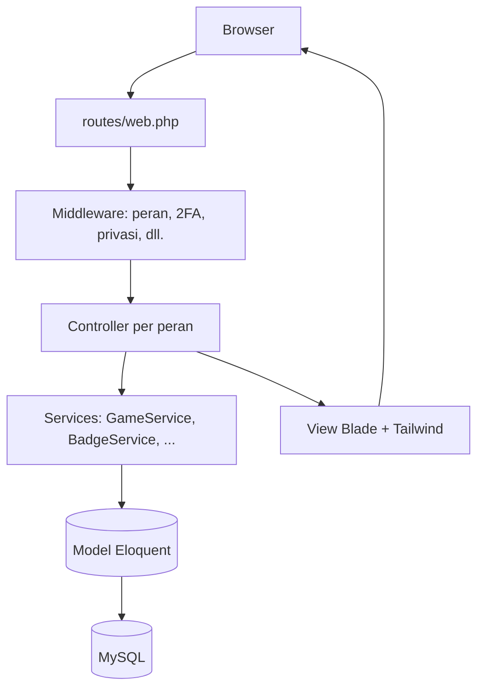
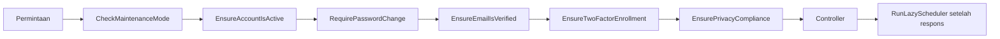
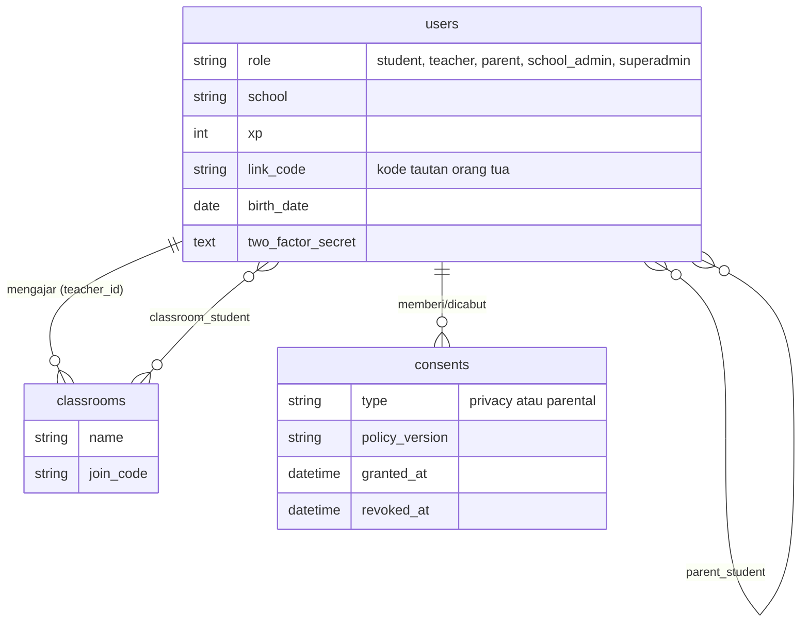
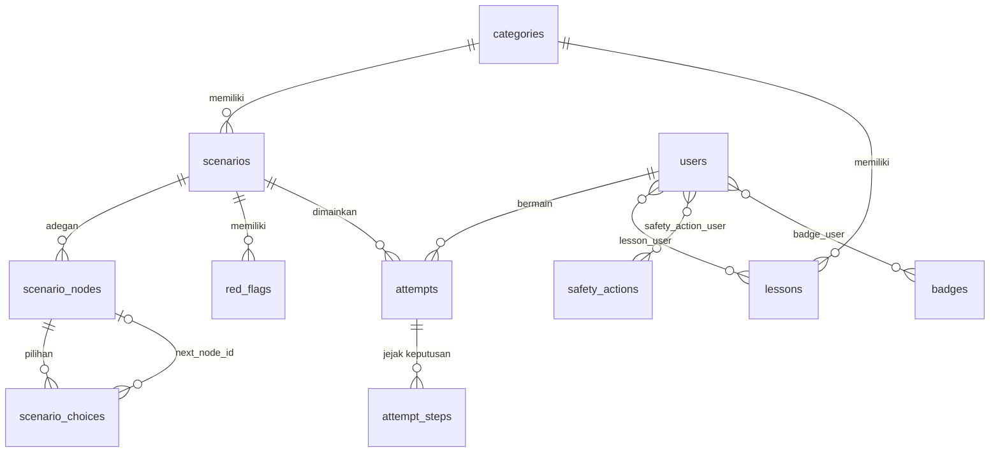

# Arsitektur & Database Guardian Digital

Dokumen ini menjelaskan cara aplikasi disusun: lapisan kode, alur satu permintaan, skema database, dan cara permainan menghitung skor. Cocok untuk juri atau pengembang yang ingin cepat memahami isi repositori.

## 1. Gambaran Umum

Guardian Digital adalah aplikasi **monolit Laravel 13 (MVC)** dengan tampilan Blade. Tidak ada API terpisah: browser meminta halaman, controller memprosesnya, dan Blade menghasilkan HTML.



| Lapisan | Lokasi | Tugas |
|---|---|---|
| Rute | `routes/web.php`, `bootstrap/app.php` (`/status`) | Memetakan URL ke controller; semua URL berbahasa Indonesia |
| Middleware | `app/Http/Middleware/` | Penjaga akses dan kebijakan (lihat bagian 2) |
| Controller | `app/Http/Controllers/{Student,Teacher,Family,SchoolAdmin,Admin}/` | Satu folder per peran; tipis, logika berat dipindah ke service |
| Service | `app/Services/` | Logika bisnis yang dipakai ulang dan mudah diuji |
| Model & Policy | `app/Models/`, `app/Policies/` | Relasi data dan aturan "siapa boleh mengubah siapa" |
| Support | `app/Support/` | Pembantu kecil: TOTP 2FA, status email, pelapor error, peringatan sistem |
| Konfigurasi | `config/security.php`, `privacy.php`, `onboarding.php` | Kebijakan keamanan, privasi, dan tur onboarding |

## 2. Alur Satu Permintaan

Middleware grup `web` dijalankan berurutan. Pengguna harus lolos semuanya sebelum controller berjalan:



| Middleware | Fungsi |
|---|---|
| `CheckMaintenanceMode` | Menampilkan halaman pemeliharaan kecuali untuk superadmin |
| `EnsureAccountIsActive` | Mengeluarkan akun yang dinonaktifkan |
| `RequirePasswordChange` | Memaksa ganti sandi bila memakai sandi sementara atau lemah |
| `EnsureEmailIsVerified` | Mewajibkan verifikasi email (bila diaktifkan di `.env`) |
| `EnsureTwoFactorEnrollment` | Memaksa superadmin dan admin sekolah memasang 2FA |
| `EnsurePrivacyCompliance` | Memastikan persetujuan privasi dan persetujuan orang tua (siswa di bawah 18 tahun) |
| `RunLazyScheduler` | Menjalankan tugas terjadwal setelah respons terkirim, untuk hosting tanpa cron |
| `EnsureRole` (alias `role:*`) | Membatasi rute per peran, dipasang di grup rute |

## 3. Skema Database

### 3.1 Pengguna, kelas, dan keluarga



### 3.2 Konten dan permainan



Cerita bercabang disimpan sebagai **graf**: setiap `scenario_nodes` adalah adegan, dan setiap `scenario_choices` menunjuk ke adegan berikutnya lewat `next_node_id`. Adegan bertipe akhir (`kind`) menutup cerita. Karena itu superadmin bisa membuat atau mengubah skenario dari panel tanpa menyentuh kode.

### 3.3 Sistem dan keberlangsungan

| Tabel | Isi |
|---|---|
| `activity_logs` | Jejak audit: siapa, melakukan apa, kapan, dari IP mana |
| `settings` | Pengaturan sistem (kunci-nilai); rahasia disimpan terenkripsi |
| `health_checks` | Riwayat pemeriksaan kesehatan, dasar perhitungan uptime |
| `error_logs` | Error aplikasi, dikelompokkan per sidik jari (kelas + file + baris) |
| `announcements` | Banner pengumuman terjadwal per peran |
| `sessions`, `cache`, `jobs` | Tabel bawaan Laravel (driver `database`) |

Migrasi sengaja dibuat **aman dijalankan ulang** (memeriksa dulu apakah tabel atau kolom sudah ada), dan ini diuji di `MigrationIdempotentTest`.

## 4. Logika Permainan

Ada di `app/Services/GameService.php` dan `BadgeService.php`.

1. Siswa memulai misi, dan dibuat satu baris `attempts` berstatus `playing`.
2. Setiap pilihan menambah baris `attempt_steps` (adegan, pilihan, poin).
3. Saat mencapai adegan akhir, skor dihitung (skala 0–100) dan `ending_kind` ditetapkan (baik / netral / buruk).
4. XP dihitung dari skor dan hanya bertambah **bila skor terbaik meningkat**:

```
xp_baru   = round(xp_misi × skor / 100)
xp_lama   = round(xp_misi × skor_terbaik_sebelumnya / 100)
xp_didapat = max(0, xp_baru − xp_lama) + (10 bila pertama kali selesai)
```

Aturan ini mencegah siswa mengulang misi yang sama hanya untuk mengejar XP.

5. `BadgeService` memeriksa syarat lencana (tipe dan ambang di tabel `badges`) dan memberikannya otomatis.

## 5. Keamanan dalam Arsitektur

| Kebutuhan | Cara |
|---|---|
| Pembatasan peran | Middleware `role:*` di rute, ditambah `UserPolicy` untuk aksi per pengguna |
| Penguncian login | 5 kali salah mengunci akun 15 menit, ditambah `throttle` per IP |
| 2FA | `app/Support/Totp.php` (RFC 6238) dan `TwoFactorService` |
| Audit | `AuditObserver` mencatat perubahan data penting ke `activity_logs` |
| Privasi | `PrivacyService` dan `AccountDataService` (unduh dan hapus data) |
| Pemantauan | `HealthService`, `ErrorReporter`, endpoint `/status` |

Rincian lengkap: [KEAMANAN-DAN-PRIVASI.md](KEAMANAN-DAN-PRIVASI.md) dan [KEBERLANJUTAN-SISTEM.md](KEBERLANJUTAN-SISTEM.md).

## 6. Mengapa Dirancang Seperti Ini

- **Monolit Laravel + Blade:** cocok untuk hosting PHP gratis (InfinityFree) tanpa proses build di server. Aset Vite sudah dibangun sebelum diunggah.
- **Sesi, cache, dan error di database:** hosting gratis tidak punya Redis, dan berkas log sulit dibuka. Dengan ini semuanya bisa dikelola dari panel.
- **Graf skenario di database:** konten bisa diubah tanpa deploy ulang, sehingga guru atau tim konten bisa menambah misi.
- **Layanan terpisah dari controller:** logika inti (skor, 2FA, backup, kesehatan) bisa diuji otomatis tanpa membuka browser.
